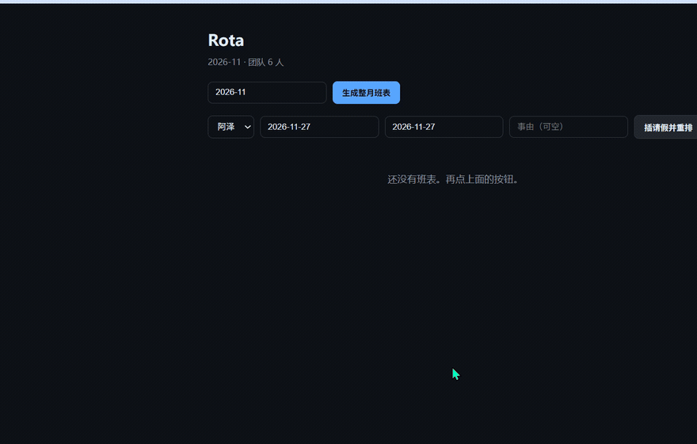
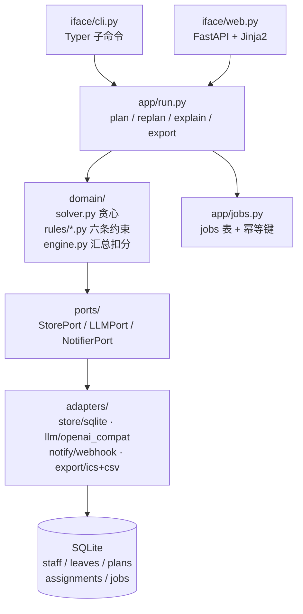

# Rota · 小团队排班

[](https://github.com/wushiyi105-jpg/rota/actions)
[]()
[](./LICENSE)



节假日调休插进来，重排一遍还公平。

排班真正的麻烦不是「排出来」，是两件事：改一个人的假，整张表就乱了；谁都觉得自己周末上多了。
Rota 把每条约束拆成一条可解释的扣分，改动只落在必要的那几天。

## 功能特性

- **六条约束，条条可解释**：`fairness.spread` 公平、`rest.night_to_morning` 休息间隔、`consecutive.over_limit` 连班上限、`coverage.gap` 缺口、`leave.conflict` 请假冲突、`skill.mismatch` 技能不匹配，外加 `load.double_booked` 一人多班。每条都带 `evidence` 与扣分。
- **最小改动重排**：插进一条请假后，旧班表里没受影响的班原样保留，只重算与这条请假相关的日子，然后打印变更 diff（谁换成了谁）。
- **技能与班次对齐**：早班要「收银」、夜班要「夜班资质」，排班时先过滤，排完再校验一遍，防止手改表把不匹配的人塞进去。
- **三种导出**：ICS 进日历（夜班自动跨到次日 08:00）、CSV 进 Excel、群里直接发的一段近七天提醒。
- **每日到期推送**：`jobs` 表带幂等键，同一月的同一天只入队一次；推送失败留 pending，下次还能重试。
- **Web + CLI 双入口**：网页看整月、插请假、导出；终端一次跑完同样的事，`--json` 给脚本读。

## 快速开始

```bash
uv sync --extra dev
uv run python -m rota seed                       # 6 名员工、2 条请假、1 个节假日
uv run python -m rota plan --month 2026-12       # 出整月表与扣分明细
uv run python -m rota replan --month 2026-12 \
  --staff-id 3 --start 2026-12-20 --end 2026-12-22 --reason 年假
uv run python -m rota web                        # http://127.0.0.1:8001
uv run python -m rota doctor                     # 配置 / 数据库 / 模型 / webhook 体检
```

12 月的真实结果：31 天 × 早/晚/夜三班共 93 条排班，六个人的加权班次是 20 / 20 / 20 / 19 / 19 / 19，扣分 0。把某人的假插进来之后，diff 只落在请假那几天。

## 为什么不用通用大模型直接问

把名单丢给模型让它排，会得到一张「看起来合理」的表，但它答不了下面四件事：

1. **算不准公平**——六个人里谁周末多值了一次，它不会去数加权次数；Rota 用 `weight_of()` 把周六日与节假日记 2 分，差 2 就报 `fairness.spread`。
2. **记不住硬约束**——夜班接早班、连上 6 天、请假期间还在表上，模型经常漏；这里的每一条都是独立函数，有独立测试。
3. **改一个人就整表重来**——模型的输出没有「旧表」概念，只能重排；Rota 的 `solve(keep=...)` 先把仍合法的班占住，再补空缺，diff 因此是最小的。
4. **说不清扣在哪**——模型的解释是自由文本，可能顺手编个「阿泽上了 12 个班」；Rota 的解释先由本地生成事实，模型只能复述，写进事实外的数字、日期、人名就整段丢弃（`domain/guard.py`）。

模型在这里只做一件事：把已算好的扣分翻成店长能读的五句话。没有 key 就是离线模式，规则文本照常输出。

## 适用场景

- **10–30 人的门店 / 值班组**：早班、晚班、夜班三档，谁有收银或夜班资质一眼对上。
- **节假日与调休频繁的团队**：法定节假日按两次计权，公平差异能指着具体日期说。
- **临时有人请假**：只重排受影响的两三天，把 diff 发到群里，不用整月重贴一遍。

## Roadmap

- **换班审批**：两个人私下换班后，走一次确认再落库，留痕。
- **工时上限**：除了班次数，再按月累计小时数卡一条红线。
- **两周视图**：网页默认只看未来 14 天，整月折叠。
- **Excel 导出**：现在给的是 CSV（Excel 直接打开）；真要 xlsx 会引 `openpyxl`，等有明确需求再加。
- **多门店**：同一批人跨店排班，技能与公平按门店分开算。

## FAQ

**没有模型 key 能用吗？**
能。排班、重排、diff、导出全部在本地算；只有 `comment` 的措辞会退化成规则文本，界面上标「离线模式」。

**请假插错了怎么办？**
`replan` 只是新增一条请假并重排，不会删旧记录。要撤销就再排一次（`plan --month`），或者直接改数据库里的 `leaves` 行。

**为什么我的班表里有「缺口」？**
当天的技能要求没人满足就会报 `coverage.gap`，扣 100 分。常见原因是符合技能的人都在请假，或者当天排了三个班但只有两个有资质的人。

**ICS 里的夜班为什么跨天？**
夜班按 22:00 到次日 08:00 生成事件，日历上会落在两天，这是有意的。

**能不能只排某几个人？**
把其他人的 `active` 置 0 即可（`staff` 表），排班时会跳过。

**Docker 镜像验证了吗？**
CI 的 `docker` job 每次执行 `docker build .`，启动容器并轮询 `/health`；本机没有 Docker，本地未重复跑。

## 命令参考

| 命令 | 作用 |
| --- | --- |
| `python -m rota seed [--db]` | 写入种子团队、技能、请假 |
| `python -m rota plan --month 2026-12 [--json]` | 生成整月班表并保存 |
| `python -m rota show --month 2026-12` | 看已保存的班表 |
| `python -m rota replan --month ... --staff-id ... --start ... --end ...` | 插请假并最小改动重排 |
| `python -m rota comment --month 2026-12` | 模型解释扣分（无 key 给离线文本） |
| `python -m rota export --month ... --format ics\|csv\|totals\|message` | 导出 |
| `python -m rota jobs [--enqueue --month ...] [--now ...]` | 入队 / 跑到期任务 |
| `python -m rota doctor` | 四项体检，失败退出码 1 |
| `python -m rota web [--port 8001]` | Web 界面（`serve` 是同义词） |

退出码：0 成功，1 运行错误（没员工、没班表），2 参数错（月份格式、日期倒挂、未知导出格式）。

## 依赖说明

| 依赖 | 解决什么 | 不装会怎样 |
| --- | --- | --- |
| `fastapi` + `uvicorn[standard]` | Web 入口与 ASGI 服务 | 只能用 CLI |
| `jinja2` | 服务端渲染整月表 | 页面拼字符串，转义与循环都得手写 |
| `python-multipart` | 表单提交（插请假） | `POST /replan` 收不到字段 |
| `pydantic` + `pydantic-settings` | 配置与校验，读 `.env` | 端口、权重、路径散落在代码里 |
| `sqlalchemy` | 人员 / 请假 / 班表 / 任务四组表 | 手写 SQL 与连接管理 |
| `alembic` | 表结构迁移，`alembic_version` 留痕 | 改表靠 `create_all`，线上没法回滚 |
| `httpx` | 模型与 webhook 调用，带超时 | 请求没有超时，卡死整条链路 |
| `typer` + `rich` | 子命令与终端表格 | 参数解析和排版全靠手写 |
| `pytest` / `pytest-cov` / `respx` / `freezegun` | 62 条测试与覆盖率 | 改一条规则不知道会碰坏什么 |
| `ruff` / `mypy` / `pip-audit` | 风格、类型、依赖漏洞 | CI 只跑测试，风格与类型漂移 |

不引 `openpyxl`：CSV 已经能被 Excel 直接打开，为了一个导出格式多背一个依赖不值。

## 工作原理



三处取舍：

1. **规则在 domain，不在入口层**：`cli.py` 与 `web.py` 只做参数与渲染，任何一条约束都在 `domain/rules/` 里，能被单独测。
2. **重排保留旧表**：`solve(keep=...)` 先占住合法的旧班，再填空；不这样做，「插一条假」会变成「整月重排」。
3. **模型输出必须过守卫**：`guard_text()` 对照事实里的数字、日期、名册，任一项对不上就整段丢弃，退回离线解释——宁可话糙，不许编数。

## 目录结构

```
rota/
├── rota/
│   ├── domain/        models.py  engine.py  solver.py  diff.py  guard.py
│   │   └── rules/     fairness.py rest.py consecutive.py coverage.py leave.py skill.py
│   ├── ports/         StorePort / LLMPort / NotifierPort
│   ├── adapters/      store/sqlite.py  llm/openai_compat.py  notify/webhook.py  export/files.py
│   ├── app/           plan.py  run.py  jobs.py
│   ├── iface/         cli.py  web.py
│   ├── config.py  doctor.py  __main__.py
├── prompts/explain.md
├── templates/index.html
├── data/seed.json
├── migrations/        Alembic 迁移
├── tests/             59 条（规则 / 求解 / 重排 / 守卫 / 导出 / 任务 / CLI / Web / doctor）
├── Dockerfile / .dockerignore / .env.example
└── .github/workflows/test.yml
```

## 质量与供应链

- CI 的 Coverage 步骤带 `--fail-under=70`，覆盖率低于 70% 直接失败。
- `tests/test_app_fake.py` 用真实 `InMemoryStore` 跑主用例，并显式标注 `StorePort` 交给 mypy 做结构校验；测试不创建 SQLite 文件。
- Audit 步骤从 `uv.lock` 导出运行时依赖，再用 `pip-audit -r` 审计；开发工具链不进发布物，运行时依赖有漏洞就让 job 失败，不用 `|| true` 吞错。

## 作者

shiyi · GitHub [@wushiyi105-jpg](https://github.com/wushiyi105-jpg) · 18384198104
